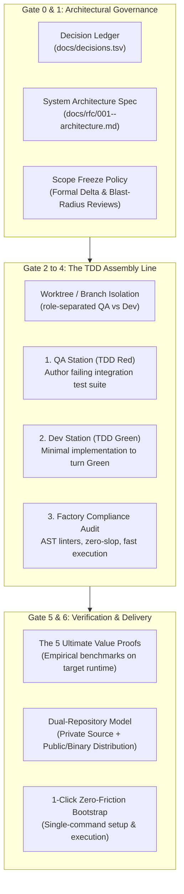
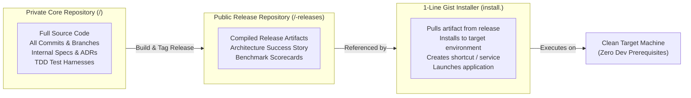

# The Generic AI-Native Software Factory Blueprint
> **A Replicable Engineering Governance & Assembly Line Framework for Enterprise Applications**
> *(Adaptable to Spring Boot / Java AI, Rust, Python, TypeScript, and Polyglot Architectures)*

---

## 1. Executive Framework Overview

The **Generic AI-Native Software Factory** is an automated, repeatable assembly line designed to produce deterministic, enterprise-grade software using autonomous AI agents paired with a human Executive Sponsor.

It enforces a fundamental rule: **Zero production code is written without prior architecture sign-off, strict Test-Driven Development (TDD) commit pairing, and automated compliance scoring.**



---

## 2. The 6 Non-Negotiable Software Factory Gates

Every subsystem slice in `<APP_NAME>` moves sequentially across 6 gated stations:

```
[ Gate 0: Governance Setup ] ➔ [ Gate 1: RFC Architecture Spec ] ➔ [ Gate 2: Compliance Harness ]
                                                                             │
[ Gate 6: Production Delivery ] 🠤 [ Gate 5: Value Proofs ] 🠤 [ Gate 3 & 4: TDD Red/Green Cycle ]
```

---

### Gate 0: Governance & Architecture Decision Ledger
Before generating code or project skeletons:
1. **Initialize `docs/decisions.tsv`**:
   Persistent, chronological ledger recording every key decision (ADR-001 through ADR-N).
   * Schema: `ID | Date | Title | Status | Context | Decision | Consequences`
2. **Author `docs/GOVERNANCE.md`**:
   * **Branching & Worktree Strategy**: Separate QA test-authoring from developer feature-authoring.
   * **3-Tier Conflict Escalation**:
     1. *Tier 1 (Append-only)*: Automated chronological merge (`decisions.tsv`, `STATUS.md`).
     2. *Tier 2 (Code diffs)*: Lead agent rebase + automated regression check.
     3. *Tier 3 (Interface drift)*: Stop-The-Line (**Andon Cord**) escalated to User.
   * **Scope Freeze Policy**: Once the spec is approved, scope is locked. Zero scope creep or trait/contract modifications without formal Delta Review.

---

### Gate 1: Architecture Specification (RFC)
Author `docs/rfc/001-<app>-architecture.md` defining:
* Problem statement, business goals, and performance budgets (latency, memory, throughput).
* Subsystem module boundaries and public contracts/interfaces.
* **The ADR-002 Invariant**: *Test our own integration and glue logic; never re-test upstream framework or model internals.*
* **Formal Human Sign-Off**: The Human Executive Sponsor must review and state:
  > *"I approve version v1.0.0 of the spec"*

---

### Gate 2: Automated Factory Compliance Harness (`scripts/audit_factory.<ext>`)
Create a fast, standalone compliance inspector that audits the project against quantitative benchmarks:

| Benchmark | Target Metric | Inspection Logic |
| :--- | :---: | :--- |
| **B1: Specification Traceability** | 100% | Scans all business modules; asserts each maps to an RFC and logged ADR. |
| **B2: TDD Test-Pairing Invariant** | 100% | Asserts every business class/module has a corresponding test suite in `tests/`. |
| **B3: Anti-Slop Code Hygiene** | Slop Index $\le 0.05$ | AST scanner prohibits conversational AI comments, unused boilerplate, and dead code. |
| **B4: Test Execution Velocity** | $< 3.0\text{ seconds}$ | Verifies test harness runs in memory with sub-second feedback. |
| **B5: Git Weight & Binary Hygiene** | 0 Leaks | Scans git tree; rejects tracked model weights ($>10\text{MB}$) or compiled binaries. |
| **B6: Scope Freeze Invariant** | Active | Asserts signed-off RFC version matches governance manifest. |
| **B7: 1-Click Bootstrap** | Verified | Asserts single-command build and launch scripts exist. |

*Output: Quantitative Scorecard (`100 / 100 [CERTIFIED SOFTWARE FACTORY GRADE]`).*

---

### Gate 3 & 4: The TDD Assembly Line (Per Subsystem Slice)

For every subsystem slice:
1. **QA Worktree / Branch (`test/<slice>-red`)**:
   * Authored by the QA Test Engineer persona.
   * Writes integration tests asserting expected behavior against mocks/stubs.
   * **Mandatory Step**: Run test suite and confirm it **fails for the right reason** (RED).
2. **Developer Worktree / Branch (`feat/<slice>`)**:
   * Authored by the Core Developer persona.
   * Implements minimal production code until tests turn **GREEN**.
   * Run language-specific strict linter (0 warnings allowed).
3. **Merge & Audit**:
   * Fast-forward merge `feat/<slice>` into `main`.
   * Run `audit_factory.<ext>` (Must score 100/100).
   * Clean up branches/worktrees.

---

### Gate 5: Empirical Value Proofs (Physical Hardware & Runtime)
Unit tests verify code syntax; **Value Proofs verify business value**. Define the **5 Ultimate Value Proofs** in `docs/ACCEPTANCE_TESTS.md`:
1. **Proof 1: Human Flow / Turnaround Latency**: End-to-end processing time under user-perceptible threshold.
2. **Proof 2: Domain Quality & Accuracy**: Measured against golden ground-truth test datasets (e.g. Accuracy $\ge 85\%$).
3. **Proof 3: Security & Network Hygiene**: Zero unauthorized external network egress or data leakage.
4. **Proof 4: Non-Destructive State & Resource Safety**: Byte-for-byte state preservation and zero resource leaks.
5. **Proof 5: Clean-Machine 1-Click Replication**: Verified 0-touch bootstrap on a fresh target machine in $< 5\text{ minutes}$.

---

### Gate 6: Dual-Repository Architecture & 1-Click Distribution
To protect core intellectual property while enabling frictionless replication:



---

## 3. Technology Stack Adaptation Guide: Spring Boot / Java AI

When applying this generic blueprint to a **Spring Boot / Java AI** project:

### Toolchain & Configuration Mapping

| Generic Factory Concept | Spring Boot / Java AI Equivalent |
| :--- | :--- |
| **Workspace Root** | Multi-module Maven (`pom.xml`) or Gradle (`settings.gradle`) root |
| **Subsystem Slices** | Modular sub-projects (`<app>-core`, `<app>-ai`, `<app>-api`, `<app>-platform`) |
| **TDD Testing Harness** | JUnit 5 + AssertJ + Testcontainers (for mock LLM/Vector DB) |
| **Mock ASR / LLM Trait** | Spring AI `ChatModel` mock, `EmbeddingModel` mock, or WireMock |
| **Strict Linter / Zero-Slop** | Spotless + Checkstyle + SpotBugs (`mvn checkstyle:check`) |
| **Compiler Warnings** | `javac -Xlint:all -Werror` |
| **Release Artifact** | Spring Boot Executable JAR / GraalVM Native Image executable |
| **1-Click Scripts** | `setup.bat` / `setup.sh` (`./mvnw clean package`), `run.bat` / `run.sh` (`java -jar`) |

### Specialized Java AI Best Practices
1. **Local Testability without Cloud Keys**:
   * Implement mock implementations of Spring AI `ChatModel` and `VectorStore` so the entire test suite executes in $< 3.0\text{ seconds}$ without requiring live OpenAI, Anthropic, or Ollama connections.
2. **GraalVM Native Image (Optional for CLI/Desktop)**:
   * If instant startup ($< 50\text{ms}$) and low memory ($< 30\text{MB}$) are needed, compile via GraalVM `native-image` to match single-binary ergonomics.
3. **Local Model Isolation**:
   * If bundling local ONNX/GGUF models (e.g. DJL - Deep Java Library or ONNX Runtime Java), ensure weights reside in `.models/` and are excluded from Git via `.gitignore`.

---

## 4. Standard Directory Skeleton for New Projects

```text
<app-root>/
├── <build-config>                # pom.xml / build.gradle / Cargo.toml
├── setup.<sh|bat>                # 1-click bootstrap & self-test
├── run.<sh|bat>                  # 1-click runtime launcher
├── install.<sh|ps1>              # 1-line target machine installer
├── scripts/
│   ├── audit_factory.<py|sh>     # 100/100 Compliance Scorecard Inspector
│   └── benchmark_suite.<ext>     # Automated empirical benchmark runner
├── docs/
│   ├── decisions.tsv             # Append-only ADR Ledger
│   ├── GOVERNANCE.md             # Worktrees, conflict escalation, scope freeze
│   ├── ACCEPTANCE_TESTS.md       # The 5 Ultimate Value Proofs
│   ├── STATUS.md                 # Live assembly line tracker
│   ├── BACKLOG.md                # Post-v1.0 backlog items
│   └── rfc/
│       └── 001-<app>-architecture.md
└── modules/ (or crates/ / src/)
    ├── <app>-core/               # Business entities & state machines
    ├── <app>-ai/                 # Model adapters, prompt templates, sanitizers
    └── <app>-platform/           # Native OS, storage, and I/O integrations
```

---

## 5. Kickoff Prompt: How to Initialize Your Next Project

To launch an AI agent on your next Spring Boot / Java AI (or any other) project using this framework, provide this initialization prompt:

> *"We are building **`<APP_NAME>`** using our **Generic AI-Native Software Factory Framework** (governed by `docs/GENERIC_SOFTWARE_FACTORY.md`). 
> 
> **Do not write any production code yet.**
> 
> We are at **Gate 0 & Gate 1**:
> 1. Initialize `docs/decisions.tsv` with our first foundational ADRs.
> 2. Create `docs/GOVERNANCE.md` establishing worktree isolation, anti-slop rules, and Scope Freeze.
> 3. Author `docs/rfc/001-<app>-architecture.md` defining our modular Spring Boot / Java AI component boundaries, interfaces, and test fixtures for my review and sign-off."*
